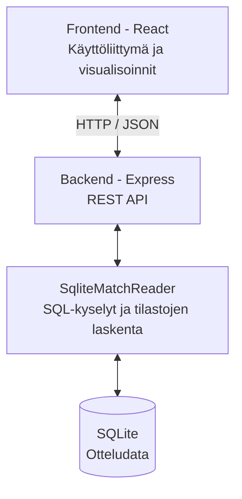

# Liiga-analyysi

## 1. Projektin kuvaus
Projektin tavoitteena oli soveltaa opintojaksoilla opittuja tekniikoita laajemmassa kokonaisuudessa. Projektissa käsitellään, analysoidaan ja visualisoidaan opettajan toimittamaa yhden jääkiekkokauden otteludataa.

Projekti yhdistää Palvelintekniikat- ja Selainalusta-opintojaksojen lopputehtävät yhdeksi toimivaksi verkkosovellukseksi. Palvelinpuoli (backend) ja selainkäyttöliittymä (frontend) on toteutettu omissa kansioissaan. Molemmilla on omat tyyppimäärityksensä ja tietomallinsa, vaikka osa niistä olisi ollut mahdollista toteuttaa yhteiskäyttöisinä.

## 2. Käytetyt teknologiat
### Kehitysympäristö
| Teknologia | Versio | Käyttötarkoitus |
|------------|--------|-----------------|
| Node.js | 24.20.0 (LTS) | JavaScript-ajoympäristö |
| npm | 12.2.0 | Riippuvuuksien hallinta |
| VS Code | - | Kehitysympäristö |
| Git ja GitHub | - | Versionhallinta |
| Postman | - | API-rajapinnan testaus |

### Backend
| Teknologia | Käyttötarkoitus |
|------------|-----------------|
| TypeScript | Ohjelmointikieli |
| Express.js | REST API -rajapinnan toteuttaminen |
| SQLite | Otteludatan tallentaminen |
| better-sqlite3 | SQLite-tietokannan käsittely |
| csv-parse | CSV-aineiston lukeminen |
| CORS | Eri origineista tulevien pyyntöjen hallinta |
| tsx | TypeScript-koodin suorittaminen kehitysvaiheessa |

### Frontend
| Teknologia | Käyttötarkoitus |
|------------|-----------------|
| TypeScript | Ohjelmointikieli |
| React | Selainkäyttöliittymän toteuttaminen |
| Vite | Kehityspalvelin ja sovelluksen koostaminen |
| Chart.js | Otteludatan visualisointi |
| react-chartjs-2 | Chart.js-kaavioiden integrointi Reactiin |
| HTML | Käyttöliittymän rakenne |
| CSS | Käyttöliittymän ulkoasu, responsiivisuus ja animaatiot |
| ESLint | Koodin staattinen analysointi |

Projektin riippuvuudet ja niiden versiot on määritelty frontend- ja backend-kansioiden package.json- ja package-lock.json-tiedostoissa.

## 3. Sovelluksen rakenne
### 3.1 Yleinen arkkitehturi

### 3.2. Kansiorakenne

```text
liiga-analyysi/
├── backend/
│   └── src/
│       ├── db/
│       ├── models/
│       ├── readers/
│       ├── scripts/
│       ├── services/
│       └── App.ts
├── frontend/
│   ├── public/
│   └── src/
│       ├── components/
│       ├── types/
│       ├── utils/
│       ├── App.tsx
│       └── App.css
├── data/
├── .gitignore
└── README.md
```
### 3.3. Backendin rakenne
| Tiedosto tai kansio | Tehtävä |
|---------------------|---------|
| App.ts | Express-palvelimen käynnistäminen ja API-endpointtien määrittely |
| MatchReader.ts | Datan lukemiseen ja analysointiin käytettävä rajapinta |
| SqliteMatchReader.ts | Reader-rajapinnan toteutus ja SQL-kyselyt |
| DataHandler.ts | CSV-aineiston lukeminen, muuntaminen ja tallentaminen tietokantaan |
| database.ts | SQLite-tietokantayhteyden muodostaminen |
| initDb.ts | Tietokannan rakenteen ja indeksien luominen |
| seedDb.ts | Tietokannan alustaminen ja otteluaineiston tuonti |
| models/ | Tietomallit ja rajapinnat |

### 3.4. Frontendin rakenne
| Tiedosto tai kansio | Tehtävä |
|---------------------|---------|
| App.tsx | Datan hakeminen, tilanhallinta, otteluiden suodatus ja näkymien vaihtaminen |
| HomePage.tsx | Etusivu ja yhteenvetotilastojen esittäminen |
| MatchCard.tsx | Yksittäisen ottelun tietojen esittäminen |
| TeamStandings.tsx | Sarjataulukon esittäminen |
| RefereeStatsList.tsx | Tuomaritilastojen esittäminen |
| TeamStatsModal.tsx | Joukkuekohtaisten tilastojen ja kaavioiden esittäminen ponnahdusikkunassa |
| TeamLogo.tsx | Uudelleenkäytettävä joukkuelogokomponentti |
| LeagueAttendanceChart.tsx | Liigan yleisömäärien kehityksen visualisointi |
| TopFivePointChart.tsx | Viiden parhaan joukkueen pistekehityksen visualisointi |
| matchUtils.ts | Otteludatan käsittelyyn liittyvät apufunktiot |
| teamLogos.ts | Joukkueiden nimien ja logojen tiedostopolkujen yhdistäminen |
| App.css | Käyttöliittymän tyylit, responsiivisuus ja animaatiot |
| index.css | Sovelluksen yleiset tyylimääritykset |
| types/ | TypeScript-rajapinnat ja tyyppimääritykset |
| public/ | Staattiset resurssit, kuten joukkuelogot ja taustakuvat |
| vite.config.ts | Viten asetukset ja API-pyyntöjen välittäminen backendille kehitysympäristössä |

## 4. Asennus ja käynnistys

### 4.1. Esivaatimukset

Sovelluksen suorittamiseen tarvitaan:

- Node.js (katso kehitysympäristön versio kohdasta 2)
- npm
- Git (mikäli projekti kloonataan GitHubista)
- Verkkoselain

SQLite-tietokantaa ei tarvitse asentaa erikseen, sillä
tietokannan käsittely tapahtuu better-sqlite3-kirjaston avulla.

### 4.2. Projektin kloonaaminen

Kloonaa projekti GitHubista:

```bash
git clone https://github.com/FabianTimplaru/liiga-analyysi.git
cd liiga-analyysi
```

Mikäli projekti toimitetaan ZIP-tiedostona, pura tiedosto
ja siirry projektin juurikansioon.

### 4.3. Backendin asentaminen ja käynnistäminen

Siirry backend-kansioon ja asenna tarvittavat riippuvuudet:

```bash
cd backend
npm ci
```

Alusta tietokanta ja tuo CSV-tiedoston otteluaineisto
SQLite-tietokantaan:

```bash
npm run db:seed
```

Käynnistä palvelin:

```bash
npm run dev
```

Backend-palvelin toimii osoitteessa:

http://localhost:3000

### 4.4. Frontendin asentaminen ja käynnistäminen

Avaa toinen terminaali projektin juurikansiossa.
Siirry frontend-kansioon ja asenna tarvittavat riippuvuudet:

```bash
cd frontend
npm ci
```

Käynnistä Viten kehityspalvelin:

```bash
npm run dev
```

Avaa sovellus verkkoselaimessa:

http://localhost:5173

### 4.5. Sovelluksen käyttäminen

Frontend- ja backend-palvelimien tulee olla käynnissä
samanaikaisesti sovelluksen käytön aikana.

Frontend välittää API-pyynnöt backend-palvelimelle
Viten proxy-asetusten avulla. Erillistä rajapinnan
osoitteen määrittämistä ei tarvita.

Palvelimet voidaan sammuttaa painamalla Ctrl + C
kummassakin terminaalissa.

## 5. Tietokannan rakenne ja alustaminen

### 5.1. Tietokanta

Sovelluksessa käytetään SQLite-tietokantaa otteluaineiston
tallentamiseen. Tietokannan käsittely tapahtuu better-sqlite3-kirjaston
avulla, eikä erillistä tietokantapalvelinta tarvita.

Tietokantatiedosto sijaitsee data-kansiossa nimellä liiga.db.
Alkuperäinen otteluaineisto sijaitsee samassa kansiossa
nimellä liiga25-26.csv.

### 5.2. Tietokannan rakenne

Tietokanta sisältää yhden matches-taulun, johon tallennetaan
kaikkien otteluiden tiedot.

| Sarake | Tietotyyppi | Kuvaus |
|--------|-------------|--------|
| id | INTEGER | Ottelun yksilöllinen tunniste (PRIMARY KEY, AUTOINCREMENT) |
| date | TEXT | Ottelupäivä muodossa YYYY-MM-DD |
| home_team | TEXT | Kotijoukkue |
| away_team | TEXT | Vierasjoukkue |
| home_goals | INTEGER | Kotijoukkueen tekemät maalit |
| away_goals | INTEGER | Vierasjoukkueen tekemät maalit |
| result | TEXT | Ottelun lopputuloksen tunniste |
| referee | TEXT | Tuomarin nimi |
| attendance | INTEGER | Ottelun katsojamäärä |

Kaikki ottelutietoja sisältävät sarakkeet on määritelty
NOT NULL -rajoitteella.

Tietokantaan luodaan lisäksi yksilöllinen indeksi
(idx_unique_match), joka muodostuu ottelupäivästä,
kotijoukkueesta ja vierasjoukkueesta.

Indeksin tarkoituksena on estää saman ottelun tallentaminen
tietokantaan useita kertoja.

### 5.3. Tietokannan alustaminen

Tietokannan alustaminen tapahtuu backend-kansiossa komennolla:

```bash
npm run db:seed
```

Alustamisprosessi koostuu seuraavista vaiheista:

1. Muodostetaan yhteys SQLite-tietokantaan.
2. Luodaan matches-taulu ja yksilöllinen indeksi, mikäli niitä
   ei ole vielä olemassa.
3. Luetaan alkuperäinen CSV-aineisto csv-parse-kirjaston avulla.
4. Muunnetaan CSV-tietueet Match-tietomallin mukaisiksi olioiksi.
5. Muunnetaan päivämäärät muotoon YYYY-MM-DD ja numeeriset
   arvot number-tietotyyppiin.
6. Tallennetaan ottelut tietokantaan yhden transaktion sisällä.
7. Tulostetaan tietokantaan tallennettujen otteluiden kokonaismäärä.

Otteluiden tallentamisessa käytetään parametrisoituja
SQL-kyselyitä sekä ON CONFLICT DO NOTHING -toimintoa,
jonka ansiosta alustamiskomento voidaan suorittaa uudelleen
ilman päällekkäisten otteluiden muodostumista.

### 5.4. Datan lukeminen

Tietokannasta lukeminen tapahtuu SqliteMatchReader-luokan
kautta, joka toteuttaa MatchReader-rajapinnan.

Luokka sisältää ottelutietojen hakemiseen sekä joukkue-,
yleisö- ja tuomaritilastojen laskemiseen tarvittavat
SQL-kyselyt.

Selainkäyttöliittymä ei ole suoraan yhteydessä tietokantaan,
vaan tiedot välitetään Express-palvelimen REST API
-rajapinnan kautta JSON-muodossa.

## 6. API-rajapinta

### 6.1. Rajapinnan toteutus

Sovelluksen REST API -rajapinta on toteutettu Express.js-kirjastolla.
Backend vastaanottaa HTTP-pyynnöt, hakee tarvittavat tiedot
SqliteMatchReader-luokan avulla ja palauttaa tulokset JSON-muodossa.

Rajapinta toimii paikallisesti osoitteessa http://localhost:3000.

Kaikki rajapinnan endpointit käyttävät GET-metodia, sillä
sovelluksen tarkoituksena on olemassa olevan otteluaineiston
analysointi ja visualisointi, ei sen muokkaaminen.

### 6.2. Endpointit

| Metodi | Endpoint | Kuvaus |
|--------|----------|--------|
| GET | / | Tarkistaa, että palvelin on käynnissä |
| GET | /api/matches | Palauttaa kaikki ottelut aikajärjestyksessä |
| GET | /api/matches/:id | Palauttaa yksittäisen ottelun tunnisteen perusteella |
| GET | /api/teams | Palauttaa joukkueiden nimet aakkosjärjestyksessä |
| GET | /api/stats/standings | Palauttaa joukkuekohtaiset tilastot ja sarjataulukon |
| GET | /api/stats/attendance | Palauttaa katsojakeskiarvon sekä pienimmän ja suurimman yleisömäärän otteluineen |
| GET | /api/stats/referees | Palauttaa tuomarikohtaiset ottelumäärät |

### 6.3. HTTP-tilakoodit

Rajapinnassa käytetään seuraavia HTTP-tilakoodeja:

| Tilakoodi | Kuvaus |
|-----------|--------|
| 200 OK | Pyyntö onnistui |
| 400 Bad Request | Ottelun tunniste on virheellinen |
| 404 Not Found | Pyydettyä ottelua tai yleisötilastoja ei löytynyt |

### 6.4. Frontendin ja backendin välinen kommunikointi

Frontend hakee tiedot backend-palvelimelta asynkronisesti
Fetch API:n sekä async/await-rakenteen avulla.

API-pyynnöissä käytetään suhteellisia osoitteita, esimerkiksi:

```typescript
const response = await fetch('/api/matches');
```

Viten proxy-asetukset välittävät /api-alkuiset pyynnöt
backend-palvelimelle porttiin 3000 kehitysympäristössä.

Backendissa käytetään lisäksi CORS-middlewarea, joka sallii
eri originista tulevat pyynnöt osoitteesta http://localhost:5173.

Haetut tiedot tallennetaan Reactin tilamuuttujiin (useState),
joita hyödynnetään käyttöliittymän eri näkymissä,
suodatustoiminnoissa ja visualisoinneissa.

## 7. Toteutetut analyysit

Sovelluksessa toteutetaan useita otteluaineistoon perustuvia
analyysejä. Osa analyyseistä suoritetaan backendissa
SQL-kyselyiden avulla ja osa frontendissa TypeScriptillä
rajapinnasta saadun aineiston perusteella.

### 7.1. Backendissa toteutetut analyysit

| Analyysi | Kuvaus |
|----------|--------|
| Ottelumäärä | Joukkuekohtainen pelattujen otteluiden määrä |
| Varsinaisen peliajan voitot | Joukkuekohtainen voittojen määrä varsinaisella peliajalla |
| Jatkoaikavoitot | Jatkoajalla tai voittolaukauskilpailussa voitetut ottelut |
| Varsinaisen peliajan tappiot | Joukkuekohtainen tappioiden määrä varsinaisella peliajalla |
| Jatkoaikatappiot | Jatkoajalla tai voittolaukauskilpailussa hävityt ottelut |
| Tehdyt maalit | Joukkueen tekemien maalien kokonaismäärä |
| Päästetyt maalit | Joukkueen päästämien maalien kokonaismäärä |
| Pisteet | Joukkueen keräämät sarjapisteet |
| Sarjasijoitus | Joukkueiden järjestäminen pisteiden ja muiden tilastojen perusteella |
| Katsojakeskiarvo | Kaikkien otteluiden keskimääräinen katsojamäärä |
| Suurin yleisömäärä | Suurin yksittäisen ottelun katsojamäärä ja kyseisen ottelun tiedot |
| Pienin yleisömäärä | Pienin yksittäisen ottelun katsojamäärä ja kyseisen ottelun tiedot |
| Tuomaritilastot | Tuomarikohtaiset ottelumäärät |

Analyyseissä hyödynnetään muun muassa SQL:n COUNT-, SUM-,
AVG-, MIN- ja MAX-funktioita sekä GROUP BY-, UNION ALL-
ja CASE-rakenteita.

### 7.2. Sarjapisteiden laskeminen

Joukkueiden sarjapisteet lasketaan otteluiden
lopputulosten perusteella seuraavasti:

| Ottelun lopputulos | Pisteet |
|--------------------|---------|
| Voitto varsinaisella peliajalla | 3 |
| Voitto jatkoajalla tai voittolaukauskilpailussa | 2 |
| Tappio jatkoajalla tai voittolaukauskilpailussa | 1 |
| Tappio varsinaisella peliajalla | 0 |

Sarjataulukko järjestetään seuraavien kriteerien perusteella:

1. Sarjapisteet
2. Varsinaisen peliajan voitot
3. Maaliero
4. Tehtyjen maalien määrä

### 7.3. Frontendissa toteutetut analyysit

| Analyysi | Kuvaus |
|----------|--------|
| Otteluiden kokonaismäärä | Aineiston sisältämien otteluiden määrä |
| Joukkueiden kokonaismäärä | Aineistossa esiintyvien joukkueiden määrä |
| Yleisömäärä yhteensä | Kaikkien otteluiden katsojamäärien summa |
| Yleisökeskiarvo | Keskimääräinen katsojamäärä ottelua kohden |
| Top 5 | Viisi sarjataulukossa parhaiten sijoittunutta joukkuetta |
| Liigan yleisömäärien kehitys | Katsojamäärien ajallinen kehitys kauden aikana |
| Top 5 -joukkueiden pistekehitys | Viiden parhaan joukkueen kumulatiivinen pistekehitys |
| Joukkuekohtainen pistekehitys | Valitun joukkueen kumulatiivinen pistekehitys |
| Joukkuekohtaiset yleisömäärät | Valitun joukkueen kotiotteluiden katsojamäärien kehitys |

Frontendissa analyyseissä hyödynnetään TypeScriptin
taulukkometodeja, kuten map(), filter(), reduce(),
sort() ja slice().

Pistekehityksen laskennassa hyödynnetään uudelleenkäytettävää
getMatchPoints-apufunktiota, jonka avulla määritetään
joukkueen yksittäisestä ottelusta saamat pisteet.
Pisteet lasketaan kumulatiivisesti aikajärjestyksessä.

## 8. Käyttöliittymä ja visualisoinnit

Käyttöliittymä on toteutettu Reactilla ja TypeScriptillä.
Ulkoasu on suunniteltu jääkiekkoteemaiseksi, ja
käyttöliittymä mukautuu erikokoisille näytöille.

Sovellus sisältää kolme päänäkymää: Etusivu, Ottelut
ja Tilastot.

### 8.1. Etusivu

Etusivulla esitetään yhteenveto otteluaineistosta:

- Otteluiden kokonaismäärä
- Joukkueiden kokonaismäärä
- Yleisömäärä yhteensä
- Yleisökeskiarvo
- Viiden parhaan joukkueen sarjataulukko
- Viiden parhaan joukkueen pistekehitys
- Liigan yleisömäärien kehitys

Etusivun tarkoituksena on antaa käyttäjälle nopeasti
yleiskuva jääkiekkokaudesta.

### 8.2. Ottelut

Ottelunäkymässä esitetään ottelut päivämäärän mukaan
ryhmiteltyinä uusimmasta vanhimpaan.

Jokaisesta ottelusta näytetään joukkueiden nimet ja logot,
lopputulos, mahdollinen jatkoaika tai voittolaukauskilpailu
sekä katsojamäärä.

Käyttäjä voi suodattaa otteluita seuraavilla perusteilla:

- Joukkue
- Kotiottelut
- Vierasottelut

Suodatettujen otteluiden määrä päivittyy automaattisesti
käyttäjän valintojen perusteella.

### 8.3. Tilastot

Tilastot-näkymä jakautuu kahteen alavalikkoon:
Sarjataulukko ja Tuomaritilastot.

Sarjataulukossa esitetään kaikkien joukkueiden sijoitukset,
ottelumäärät, voitot, tappiot, tehdyt ja päästetyt maalit
sekä sarjapisteet.

Tuomaritilastoissa esitetään tuomarikohtaiset ottelumäärät
suurimmasta pienimpään.

### 8.4. Joukkuekohtaiset tilastot

Joukkueen nimeä tai logoa painamalla avautuu
joukkuekohtainen tilastoikkuna (modal).

Tilastoikkuna voidaan avata kolmesta eri näkymästä:

- Etusivun Top 5 -sarjataulukosta
- Ottelunäkymästä
- Sarjataulukosta

Tilastoikkunassa esitetään joukkueen sarjasijoitus,
sarjataulukon tilastot, kotiotteluiden yleisömäärien
kehitys sekä kumulatiivinen pistekehitys.

Samaa React-komponenttia hyödynnetään kaikissa
kolmessa näkymässä.

### 8.5. Datan visualisointi

Visualisoinnit on toteutettu Chart.js- ja
react-chartjs-2-kirjastojen avulla.

| Visualisointi | Kaaviotyyppi | Sijainti |
|---------------|--------------|----------|
| Liigan yleisömäärien kehitys | Viivakaavio | Etusivu |
| Top 5 -joukkueiden pistekehitys | Viivakaavio | Etusivu |
| Joukkuekohtaiset yleisömäärät | Viivakaavio | Tilastoikkuna |
| Joukkuekohtainen pistekehitys | Viivakaavio | Tilastoikkuna |

Kaaviot ovat interaktiivisia, ja käyttäjä voi tarkastella
yksittäisiä datapisteitä työkaluvihjeiden (tooltip) avulla.

### 8.6. Responsiivisuus ja käytettävyys

Käyttöliittymän responsiivisuus on toteutettu CSS Grid-,
Flexbox- ja media query -rakenteiden avulla.

Mobiilinäkymässä käyttöliittymää mukautetaan seuraavasti:

- Tilastokorttien ja kaavioiden asettelua muutetaan.
- Navigointipainikkeiden kokoa pienennetään.
- Joukkueiden logojen kokoa ja elementtien välistä
  etäisyyttä pienennetään.
- Joukkuekohtaisessa tilastoikkunassa näytetään vain
  sarjasijoitus, joukkue, ottelumäärä ja pisteet.
- Tilastoikkunan kaaviot esitetään allekkain.
- Laajaa sarjataulukkoa voidaan vierittää vaakasuunnassa.

Käytettävyyttä parantavat lisäksi:

- Näytön yläreunaan kiinnittyvä navigointipalkki
- Kiinnittyvät suodatus- ja tilastovalikot
- Sarjataulukon kiinnittyvä otsikkorivi
- Taulukko- ja ottelurivien korostaminen
- Joukkuelogojen CSS-animaatiot
- Joukkuekohtaisen tilastoikkunan sulkeminen
  Escape-näppäimellä

### 8.7. Visuaalinen suunnittelu

Käyttöliittymän visuaalista ilmettä on kehitetty
jääkiekkoaiheisilla elementeillä, kuten joukkuelogoilla,
jäähallin taustakuvilla ja yhtenäisellä värimaailmalla.

Joukkuelogot on toteutettu uudelleenkäytettävänä
React-komponenttina. Logot suurenevat ja animoituvat,
kun käyttäjä siirtää hiiren ottelu- tai sarjataulukkorivin
päälle.

Joukkuekohtaisessa tilastoikkunassa käytetään erillisiä
jääkiekkokentän taustakuvia työpöytä- ja mobiilinäkymille.
Taustakuvan päällä käytetään vaaleaa peittokerrosta
tilastojen ja kaavioiden luettavuuden säilyttämiseksi.

## 9. Testaus

Sovellusta testattiin manuaalisesti kehityksen eri vaiheissa.
Testauksessa keskityttiin API-rajapinnan toimintaan,
tietokannan käsittelyyn, käyttöliittymän toiminnallisuuksiin
sekä responsiivisuuteen.

### 9.1. API-rajapinnan testaus

Backendin API-rajapintaa testattiin Postmanilla sekä
Visual Studio Coden test.http-tiedoston avulla.

Testauksessa tarkasteltiin endpointtien palauttamia tietoja,
JSON-vastausten rakennetta ja HTTP-tilakoodeja.

| Testattava toiminto |
|---------------------|
| Palvelimen toiminnan tarkistaminen |
| Kaikkien otteluiden hakeminen |
| Yksittäisen ottelun hakeminen |
| Joukkueiden hakeminen |
| Sarjataulukon hakeminen |
| Yleisötilastojen hakeminen |
| Tuomaritilastojen hakeminen |

### 9.2. Tietokannan testaus

Tietokannan toimintaa testattiin alustamalla tietokanta
CSV-aineiston perusteella ja tarkastelemalla
tietokannasta palautettuja tietoja.

Tietokannan alustamisen yhteydessä tulostetaan
tallennettujen otteluiden kokonaismäärä.

### 9.3. Käyttöliittymän testaus

Käyttöliittymää testattiin kehityksen aikana
työpöytä- ja mobiilinäkymissä.

| Testattava toiminto | Odotettu tulos |
|---------------------|----------------|
| Navigointi | Näkymät vaihtuvat oikein |
| Joukkuesuodatus | Näytetään valitun joukkueen ottelut |
| Koti- ja vierasotteluiden suodatus | Näytetään valintaa vastaavat ottelut |
| Sarjataulukko | Joukkueet esitetään sijoitusjärjestyksessä |
| Joukkuekohtainen tilastoikkuna | Valitun joukkueen tiedot ja kaaviot näytetään |
| Kaavioiden interaktiivisuus | Datapisteiden tiedot ovat tarkasteltavissa |
| Joukkuelogot | Jokaiselle joukkueelle näytetään oikea logo |
| Responsiivisuus | Käyttöliittymä mukautuu näytön kokoon |
| Kiinnittyvät navigointielementit | Navigointi säilyy näkyvissä vieritettäessä |

### 9.4. Mobiilitestaus

Responsiivisuutta testattiin selaimen kehittäjätyökalujen
mobiiliemulaattorilla sekä fyysisellä mobiililaitteella.

Sovellus jaettiin mobiililaitteelle Visual Studio Coden
port forwarding -toiminnon avulla.

Testauksen perusteella tehtiin muutoksia muun muassa
ottelurivien asetteluun, joukkuelogojen kokoon,
tilastoikkunan taulukkorakenteeseen ja kaavioiden
responsiivisuuteen.

### 9.5. Testausmenetelmät

Testaus toteutettiin manuaalisesti.
Projektissa ei toteutettu automatisoituja yksikkö-
tai integraatiotestejä.

## 10. Kuvakaappaukset

Sovelluksen työpöytä- ja mobiilinäkymien kuvakaappaukset
löytyvät [screenshots-kansiosta](./screenshots).

## 11. Lähteet

### Otteluaineisto

- Opettajan toimittama Liiga-kauden 2025–2026 CSV-aineisto.

### Tekninen dokumentaatio

- TypeScript: https://www.typescriptlang.org/docs/
- React: https://react.dev/
- Express.js: https://expressjs.com/
- SQLite: https://www.sqlite.org/docs.html
- Chart.js: https://www.chartjs.org/docs/
- Vite: https://vite.dev/

### Visuaaliset materiaalit

- Joukkuelogot: https://www.footylogos.com/competition/liiga
- Jääkiekkokentän taustakuvat: luotu tekoälyllä (ChatGPT).

Joukkuelogojen oikeudet kuuluvat niiden alkuperäisille
oikeudenhaltijoille. Sovellus on toteutettu opiskeluprojektina,
eikä se ole Liigan virallinen verkkosivusto.

### Tekoälyn hyödyntäminen

Projektin toteutuksessa hyödynnettiin ChatGPT:tä ohjelmoinnin
tukena ja interaktiivisena opettajana